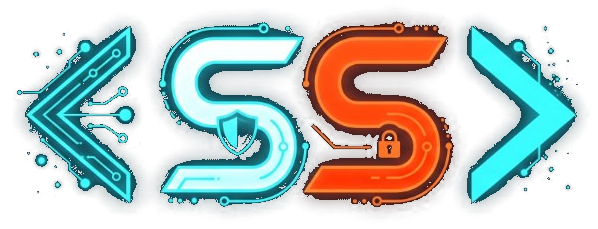

# Sundarji S — Cybersecurity & Full-Stack Developer Portfolio

An interactive, responsive portfolio showcasing defensive cybersecurity capabilities, full-stack architectures, hackathon projects, and national certifications.



## ⚡ Tech Stack & Highlights

- **Frontend Core**: Semantic HTML5, Modular CSS3 (Custom Properties & Glassmorphism), Vanilla JavaScript ES6+
- **Interactive Graphics**: [Three.js](https://threejs.org/) 3D Cyber Core Ambient Particle Canvas
- **Design Palette**: Powder Blue (`#93c5fd`), Pure White (`#ffffff`), and Vibrant Racing Orange (`#ff5500`)
- **Key Features**:
  - Interactive Project Showcase with Case Studies and GitHub links
  - Categorized Technical Skills Matrix (Cybersecurity, Development, Architecture)
  - Interactive Certifications Gallery with modal previews and verification badges
  - Curated Book Reading Accordion with takeaways & leadership insights
  - Fully responsive layout across mobile, tablet, and desktop

## 📂 Repository Structure

```text
├── index.html        # Main portfolio layout and semantic structure
├── style.css         # Styling, dark-theme variables, animations & media queries
├── app.js            # Particle canvas, interactive modals, accordion, and typewriter
└── assets/           # Certificates, project banners, logos, and favicon
```

## 🚀 Quick Start / Local Preview

To view the portfolio locally:

```bash
# Clone the repository
git clone https://github.com/sundarjis18-lang/SS-portfolio.git

# Navigate into the project folder
cd SS-portfolio

# Open index.html in your browser or run a simple local server:
python -m http.server 8000
```
Then navigate to `http://localhost:8000` in your web browser.

## 📬 Connect

- **GitHub**: [@sundarjis18-lang](https://github.com/sundarjis18-lang/)
- **Institution**: Sri Ramakrishna College of Arts & Science (SRCAS)

